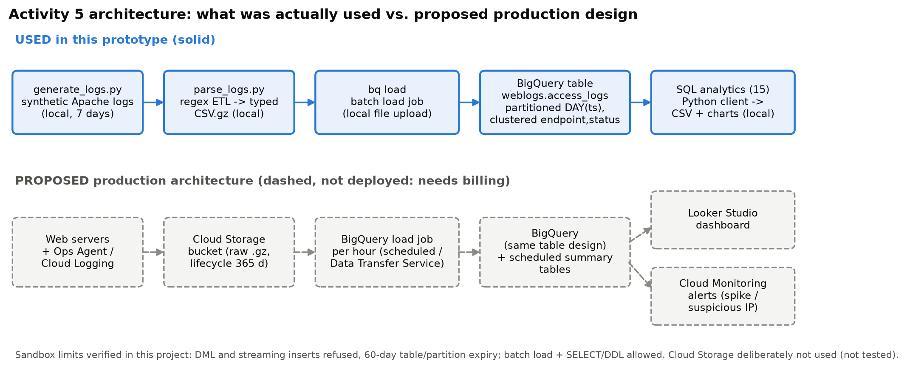

# Activity 5 – Cloud-Based Big Data Analytics: Server-Log Analytics on Google BigQuery

## What it does
Seven days of synthetic web-server access logs for an online shop (774,130 requests,
26 Oct – 1 Nov 2026) are parsed locally, **batch-loaded into Google BigQuery (Sandbox, no
billing)** and analysed with 15 SQL queries: status/error frequencies, popular endpoints,
traffic over time, peak periods, IP behaviour, failure-spike detection and suspicious-traffic
detection. Every BigQuery result is re-computed locally with pandas and compared (23/23 checks
pass), and detections are compared with incidents deliberately planted in the data.



## Services: actually used vs. proposed
| Component | Status | Notes |
|---|---|---|
| BigQuery (dataset `weblogs`, table `access_logs`, location asia-south1) | **USED** | Sandbox; partitioned by DAY(ts), clustered by endpoint, status |
| BigQuery batch load job (`bq load` of a local CSV.gz) | **USED** | 1 file, 774,130 rows, 0 bad records |
| BigQuery SQL (on-demand analysis), INFORMATION_SCHEMA.JOBS_BY_USER | **USED** | 20 query jobs per run, 739 MiB processed |
| Google Cloud CLI (`gcloud`, `bq`) + BigQuery Python client | **USED** | client authenticated with the gcloud user token (no key files) |
| Cloud Billing Catalog API (read-only) | **USED** | official prices for the cost estimate (`pricing/`) |
| Cloud Storage bucket (raw log landing zone) | PROPOSED only | deliberately not created (no billable resources); Google states Cloud Storage needs billing - not tested here |
| Ops Agent / Cloud Logging export, scheduled loads / Data Transfer Service | PROPOSED only | production ingestion |
| Looker Studio dashboard, Cloud Monitoring alerts, scheduled summary tables | PROPOSED only | production consumption |

## Dataset (synthetic) and planted incidents
`generate_logs.py` (seed 55) writes Apache combined-format lines with response time, for
a pool of 24,000 client IPs (22,313 appear in the week), 30 distinct endpoints incl. scanner paths, browsers / mobile / app / search bots, and a daily cycle.
Attacker IPs come from documentation ranges (203.0.113.0/24, 198.51.100.0/24). 25 lines are
deliberately truncated to test the parser.

| Id | Planted incident (IST) | Expected signal |
|---|---|---|
| I1 | Wed 28 Oct 14:10–14:35 payment outage | 503/504 on /api/v1/payments, /checkout |
| I2 | Fri 30 Oct 09:00–10:30 bad deployment | 500 on /api/v1/recommendations |
| I3 | Thu 29 Oct 02:00–03:00 credential stuffing, 203.0.113.17–19 | ~6,000 POST /login, mostly 401 |
| I4 | Sat 31 Oct 06:00–18:00 scraper, 198.51.100.77 | 27,020 product pages, 429 when throttled |
| I5 | Tue 27 Oct 22:00–22:20 vulnerability scan, 198.51.100.200 | /.env, /wp-login.php … → 404/403 |
| I6 | Fri 30 Oct 20:00–22:00 sale campaign | traffic × 1.7 |

## Table design
`bq/schema_access_logs.json`: `ts TIMESTAMP` (REQUIRED), `client_ip STRING`, `method STRING`,
`endpoint STRING` (path template, ids → `{id}`), `path`, `query_string`, `protocol`,
`status INT64`, `bytes_sent INT64`, `response_ms INT64`, `referrer`, `user_agent`, `ua_class`.
* **Partitioned by DAY on `ts`** → time-filtered queries read only the needed days (cost).
* **Clustered by `endpoint, status`** → the most common filter columns are co-located.
* Timestamps keep the `+05:30` offset in the CSV; BigQuery stores UTC; queries convert with
  `DATETIME(ts, 'Asia/Kolkata')`.

## Run it (project root, PowerShell)
```powershell
gcloud auth login ; gcloud config set project bigdatasla       # once (browser login by the user)
powershell -ExecutionPolicy Bypass -File activity5_bigquery\run_all.ps1     # full clean-start pipeline
# or step by step
.venv\Scripts\python.exe activity5_bigquery\generate_logs.py      # raw logs  -> data/raw
.venv\Scripts\python.exe activity5_bigquery\parse_logs.py         # typed CSV -> data/processed
powershell -ExecutionPolicy Bypass -File activity5_bigquery\bq_setup.ps1   # dataset, table, batch load
.venv\Scripts\python.exe activity5_bigquery\sandbox_tests.py      # verify sandbox limits
.venv\Scripts\python.exe activity5_bigquery\run_queries.py        # 15 queries + pruning -> results/*.csv
.venv\Scripts\python.exe activity5_bigquery\verify_results.py     # pandas cross-check + ground truth
.venv\Scripts\python.exe activity5_bigquery\cost_estimate.py      # actual vs hypothetical cost
.venv\Scripts\python.exe activity5_bigquery\charts.py
```

## Verified results (clean-start run 2026-11-03 22:03–22:07 IST)
**Load**: batch load job, 1 file, 774,130 rows, 0 bad records; table 165.2 MiB logical
(224 B/row); 25 malformed lines rejected by the parser before loading.

**Overview (Q01)**: 774,130 requests, 22,313 IPs, 30 endpoints, 25.03 GiB served, average 130.7 ms,
21,728 4xx and 4,201 5xx (3.35 % of requests are errors).

| Question | Query | Main result |
|---|---|---|
| Status codes | Q02 | 200 = 88.48 %, 304 = 6.28 %, 429 = 1.13 %, 401 = 0.87 %, 404 = 0.72 %, 500 = 0.33 % |
| Most accessed endpoints | Q03 | /products/{id} 26.6 % of traffic (p50 118 ms, p95 249 ms), /products 9.7 %, product images 8.7 % |
| Errors by endpoint | Q04 | /products/{id}: 8,733 × 429 (scraper) + 4,872 × 404; /login: 6,741 × 401 (25 % error rate) |
| Volume over time | Q05/Q06 | ~101–113k requests on weekdays, 136k on Saturday (scraper adds 27k) |
| Peak periods | Q07/Q08 | all 10 busiest 5-minute windows on Fri 30 Oct 20:05–22:00 (sale), max 1,198 req = 3.99 req/s |
| IP patterns | Q09 | busiest client is a legitimate search bot (27,549 req, max 15/min); the scraper is second (27,017, max 41/min) |
| Failure spikes | Q10/Q11 | 4 incidents flagged (below) |
| Credential stuffing | Q12 | 203.0.113.17–19: ~1,930 failed logins each in one hour, 33 attempts/min, **52–55 successful logins each** |
| Vulnerability scan | Q13 | 198.51.100.200: 1,203 probes, 12 sensitive paths, 100 % 4xx, Nmap user agent |
| Automated high-rate clients | Q14 | 198.51.100.77 (27,017 req, 720 minutes ≥ 20 req/min, 8,733 × 429) + the 3 stuffing IPs |
| Client types | Q15 | browsers 42.7 %, mobile 33.2 %, app 12.7 %, search bots 7.0 %, scripts/tools 4.4 % (47 % errors) |

**Failure-spike detection (Q11) vs. planted incidents**
| Flagged incident (IST) | Top failing endpoints | Ground truth |
|---|---|---|
| 28 Oct 14:10–14:35 | /checkout (43), /api/v1/payments (19) | I1 exactly |
| 29 Oct 15:45–15:50 | spread over normal endpoints (8 failures, z = 4.1) | **false positive** |
| 30 Oct 09:10–09:30 and 09:40–10:25 | /api/v1/recommendations (26, 74) | I2 (split in two; 09:00–09:10 missed) |

**Verification**: 23/23 checks pass (`results/verification.csv`): every query result identical to
the pandas re-computation of the local dataset; I1–I6 all found; Q12/Q13 return exactly the
planted IPs; scraper counts reconcile with the generator minus the 3 scraper lines the parser rejected.

## Sandbox limitations (verified, `04_sandbox_tests.log`)
| Feature | Result in this project |
|---|---|
| Billing | `billingEnabled = False` |
| SELECT queries, DDL (CREATE TABLE), batch load jobs | allowed |
| DML (INSERT / UPDATE) | refused: "DML queries are not allowed in the free tier" |
| Streaming inserts | refused: "Streaming insert is not allowed in the free tier" |
| Table / partition expiry | forced 60 days (dataset default 5,184,000,000 ms); data dated > 60 days ago would expire on load |
| Cloud Storage bucket | NOT TESTED – deliberately not attempted to avoid creating resources; raw logs were batch-loaded from the local file instead |

## Cost
**Actual (Sandbox):** 165 MiB stored (1.6 % of the 10 GiB free tier); 20 queries processed 739 MiB
and were billed 778 MiB (every query is billed at least 10 MiB) = 0.07 % of the 1 TiB monthly free
tier; batch loading has no SKU in the billing catalog. **Cost: USD 0.00.**

**Hypothetical production (not deployed)**, official asia-south1 prices from the Cloud Billing
Catalog API (retrieved 2026-11-03): analysis USD 7.50/TiB after 1 TiB free; active storage
USD 0.023/GiB-month after 10 GiB free (long-term 0.016); Cloud Storage Standard Mumbai
USD 0.023/GiB-month. Assumptions (`results/cost_assumptions.csv`): 20 GiB raw logs/day, 90-day
retention in BigQuery, 1-year raw archive in Cloud Storage, 15 dashboard queries per hour over the
last 24 h, 4 ad-hoc weekly queries per day, ratios measured in this run.

| Item | Quantity | USD / month |
|---|---|---|
| BigQuery analysis (on-demand) | 62.4 TiB | 460.19 |
| BigQuery active storage | 1,900 GiB | 43.46 |
| Cloud Storage Standard (raw .gz) | 677 GiB | 15.57 |
| Cloud Storage Class A operations | 86,400 | 0.41 |
| Batch load jobs | – | 0.00 |
| **Total** | | **≈ 520** |

Without partition pruning the same dashboards would scan ~5,200 TiB/month (≈ USD 39,000) –
partitioning is the single biggest cost control. Query cost would drop further with pre-aggregated
summary tables (scheduled queries) or capacity (slot) pricing.

## Partition / column pruning (measured, `results/pruning_comparison.csv`)
| Query | MiB processed |
|---|---|
| status column, whole table | 5.91 |
| one UTC day (1 partition) | 1.64 |
| one IST day (spans 2 UTC partitions) | 3.22 |
| + long `user_agent` column | 78.43 |
| IST day + `endpoint` filter (cluster column) | 6.15 |
All small queries are billed the 10 MiB minimum; clustering gives no benefit on partitions of only
~25 MiB and the filter column itself must be read.

## Issues and design decisions (viva notes)
1. **Dates moved to the last full week** (26 Oct – 1 Nov 2026): the Sandbox expires partitions 60 days
   after their date, so logs dated a year earlier would have been deleted immediately on load.
2. **Spike detector redesigned.** The first version compared each 5-minute bucket with the mean/stddev
   of the previous hour of failures; once an outage began, its own failures inflated the baseline
   ("self-masking") and only 1 bucket per incident was flagged. Final version: expected failures =
   requests × failure rate of the previous ~24 h *excluding the last hour*, Poisson z ≥ 4 and ≥ 8
   failures; buckets ≤ 10 min apart merged. Thresholds were chosen on this week's data (z ≥ 4 gave
   1 false positive vs 3 at z ≥ 3) and should be validated on other weeks.
3. **BigQuery rejected a correlated subquery** (top endpoints per incident) – rewritten as an
   aggregate CTE + join.
4. **PowerShell 5.1** adds a UTF-8 BOM when piping SQL into `bq query` (error "Illegal input character
   \357"); queries are therefore run through the BigQuery Python client using the gcloud token.
   The first setup log was UTF-16 with Indian digit grouping (7,74,130) – fixed (UTF-8, invariant culture).
5. **Scraper ground-truth check** first failed: 3 of the 25 truncated lines belonged to the scraper and
   were (correctly) rejected by the parser; the check now reconciles generator − rejected = loaded.
6. **Official prices** were fetched from the Cloud Billing Catalog API because the pricing web pages
   could not be read by the tooling; SKU ids are cited in `cost_estimate.py`.
7. A **legitimate search bot is the busiest IP** – volume alone is not evidence of abuse; rate, user
   agent, error ratio and path pattern (Q12–Q14) separate abusive from normal automation.
8. `bq_setup_console.png` capture came out blank (window wider than the screen); replaced by a
   console window displaying the genuine setup log (`bq_setup_log_console.png`).

## Limitations and improvements
* Synthetic data with planted incidents; real logs are noisier (proxies, NAT, IPv6, bot impersonation –
  real Googlebot should be verified by reverse DNS).
* Sandbox: no DML/streaming and 60-day expiry (verified); Cloud Storage not used (not tested) – the production ingestion path is
  designed but not deployed.
* Detection thresholds are static and tuned on one week; production would use seasonal baselines,
  per-endpoint models and alerting via Cloud Monitoring.
* One region (asia-south1); no access control beyond the project owner; no PII handling (IP addresses
  are personal data under many privacy laws – production would mask or truncate them).

## Viva questions to prepare
* Why BigQuery (serverless, columnar, pay-per-bytes-scanned) instead of Hive on a cluster?
* What does partitioning by `ts` save, and why did an IST-day filter read two partitions?
* Why is batch loading preferred over streaming here, and why are both DML and streaming blocked?
* Explain the z-score spike detector and the self-masking problem of a rolling baseline.
* Why were the credential-stuffing attempts with 200 responses the most serious finding?
* How would you move from this prototype to production (GCS, scheduled loads, dashboards, alerts)?
